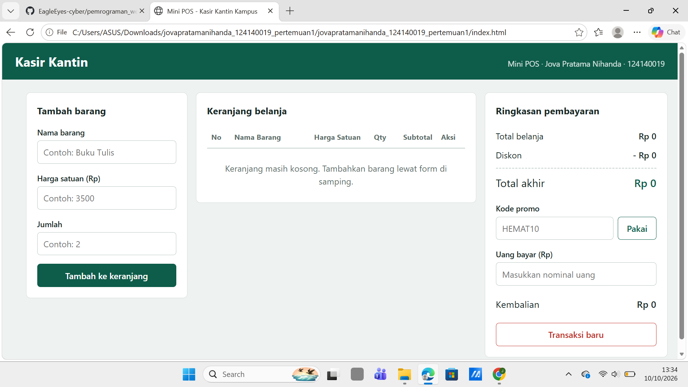
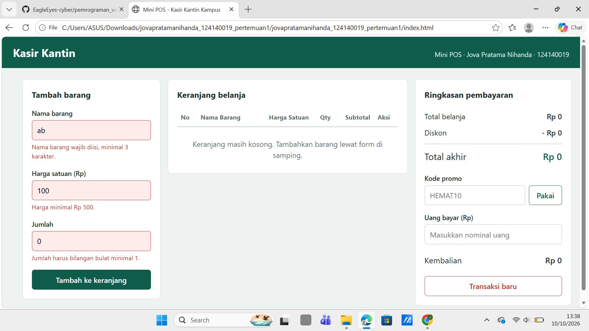
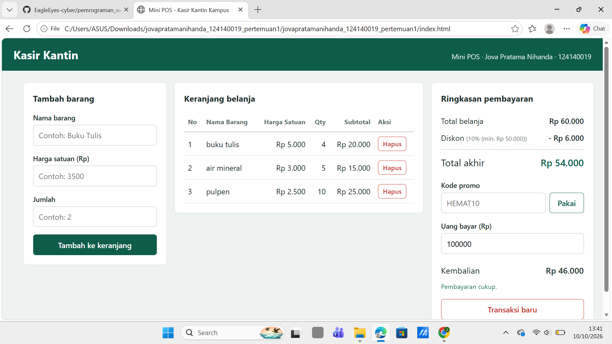

# Mini POS - Kasir & Keranjang Belanja Sederhana

## Identitas
- **Nama Lengkap:** Jova Pratama Nihanda
- **NIM:** 124140019
- **Kelas Praktikum:** RA

## Deskripsi Aplikasi
Mini POS adalah aplikasi web kasir untuk kantin atau toko kampus. Kasir memasukkan barang belanjaan, aplikasi menghitung subtotal, total, diskon, dan kembalian secara otomatis. Isi keranjang disimpan di `localStorage` sehingga tidak hilang saat halaman di-refresh. Aplikasi ini menggabungkan tiga kompetensi praktikum: validasi form, kalkulator otomatis, dan manajemen keranjang berbasis localStorage.

## Panduan Menjalankan
1. Clone repository: `git clone https://github.com/EagleEyes-cyber/pemrograman_web_itera_124140019.git`
2. Buka folder `jovapratamanihanda_124140019_pertemuan1` di VS Code.
3. Klik kanan `index.html`, pilih **Open with Live Server** (atau buka langsung `index.html` di browser).

## Daftar Fitur
- [x] Validasi nama barang (wajib, minimal 3 karakter)
- [x] Validasi harga (angka, minimal Rp 500)
- [x] Validasi qty (bilangan bulat, minimal 1)
- [x] Pesan error merah di bawah input; barang tidak masuk keranjang jika tidak valid
- [x] Form otomatis di-reset setelah barang berhasil ditambahkan
- [x] Subtotal per baris (harga x qty) dan total belanja otomatis
- [x] Diskon 10% otomatis jika total >= Rp 50.000, atau lewat kode promo `HEMAT10`
- [x] Tampilan nominal diskon dan total akhir
- [x] Kalkulator uang bayar dan kembalian, dengan keterangan jika uang kurang
- [x] Tabel keranjang (No, Nama Barang, Harga Satuan, Qty, Subtotal, Aksi)
- [x] Tombol Hapus per item dengan perhitungan ulang otomatis
- [x] Penyimpanan persisten dengan `localStorage` (`JSON.stringify` / `JSON.parse`)
- [x] Tombol Transaksi Baru untuk mengosongkan keranjang dan localStorage
- [x] Tampilan responsif dan format Rupiah

## Tangkapan Layar
> Simpan screenshot ke folder `screenshots/` lalu pastikan nama file sesuai.

| Tampilan | Gambar |
|---|---|
| Form input utama |  |
| Validasi error |  |
| Hasil perhitungan & tabel keranjang |  |

## Penjelasan Teknis Singkat
**Validasi input.** Fungsi `validasiForm()` membaca nilai ketiga input, memeriksa aturan masing-masing (nama >= 3 karakter, harga >= 500, qty bilangan bulat >= 1), lalu menampilkan pesan error di elemen `<p class="error">` di bawah input yang salah. Jika ada satu saja yang tidak valid, fungsi mengembalikan `null` dan barang tidak ditambahkan. Jika valid, data dimasukkan ke array `keranjang` dan form di-reset.

**Algoritma kalkulator.** `hitungTotal()` menjumlahkan `harga * qty` seluruh item dengan `reduce()`. `hitungDiskon()` memberi 10% jika total >= Rp 50.000 atau kode `HEMAT10` aktif (tidak ditumpuk). Total akhir = total belanja - diskon. Kembalian = uang bayar - total akhir; jika uang bayar kurang, ditampilkan keterangan kekurangannya. Semua dihitung ulang oleh `render()` setiap ada perubahan.

**Serialisasi localStorage.** Setiap kali keranjang berubah, `simpanKeranjang()` menjalankan `localStorage.setItem(key, JSON.stringify(keranjang))`. Saat halaman dimuat, `muatKeranjang()` membaca dengan `JSON.parse(localStorage.getItem(key))` (dibungkus `try/catch` agar data rusak tidak membuat aplikasi error). Tombol Transaksi Baru memanggil `localStorage.removeItem(key)`.

## Struktur Folder
```
jovapratamanihanda_124140019_pertemuan1/
├── index.html
├── style.css
├── script.js
├── README.md
├── screenshots/
└── modul/            # latihan materi (buka modul/index.html)
```

## Latihan Modul
Folder `modul/` berisi 5 halaman latihan dari materi Pertemuan 1: Variabel & Kondisional, Loop & Fungsi, Array & Objek (CRUD), DOM & Fetch API (search, pagination, dark mode), serta Form Mahasiswa & Todo List dengan localStorage.
