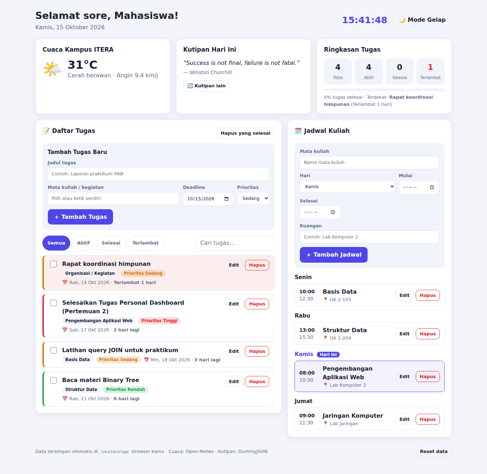
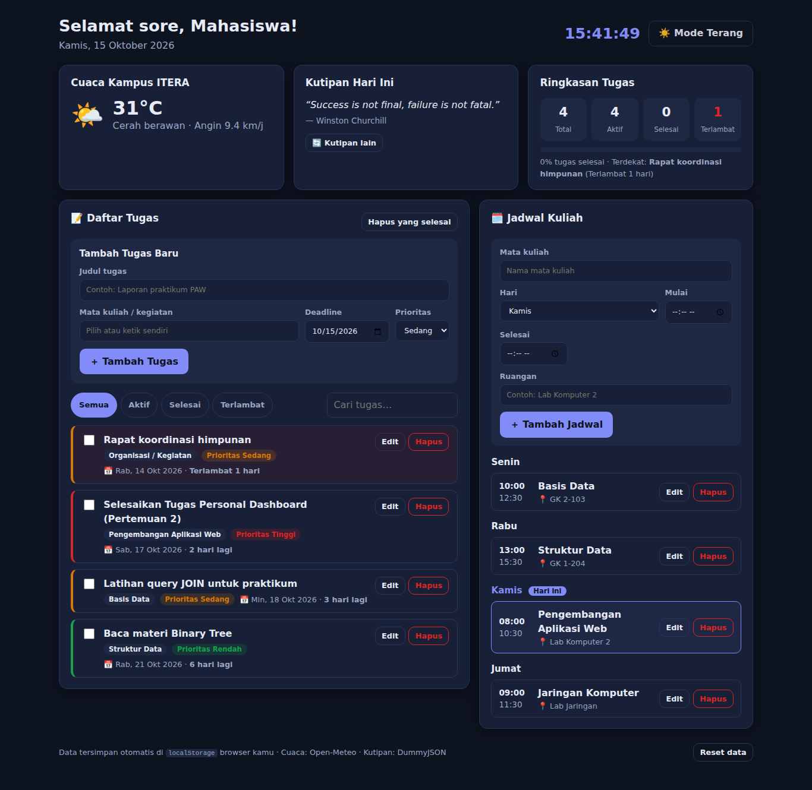

# KuliahKu Dashboard

**Tugas Praktikum Pertemuan 2 – JavaScript Next Gen (ES6+)**
Praktikum Pengembangan Aplikasi Web · Teknik Informatika · ITERA

- Nama: JOVA PRATAMA NIHANDA
- NIM: 124140019

---

## 1. Deskripsi Aplikasi

**KuliahKu Dashboard** adalah personal dashboard untuk membantu mahasiswa mengatur kegiatan perkuliahan sehari-hari dalam satu halaman. Masalah yang ingin diselesaikan: tugas dan jadwal kuliah sering tersebar di banyak tempat (grup chat, catatan, kalender), sehingga deadline mudah terlewat.

### Fitur

| Fitur | Penjelasan |
| --- | --- |
| **Manajemen Tugas (CRUD)** | Tambah, edit, hapus, dan tandai selesai. Tiap tugas punya judul, mata kuliah, deadline, dan prioritas. |
| **Penanda Deadline** | Menampilkan sisa hari ("Besok", "3 hari lagi", "Terlambat 1 hari"); tugas terlambat diberi warna merah. |
| **Filter & Pencarian** | Filter Semua / Aktif / Selesai / Terlambat dan pencarian teks (dengan debounce). |
| **Jadwal Kuliah Mingguan (CRUD)** | Tambah, edit, hapus jadwal; dikelompokkan per hari dan hari ini otomatis disorot. Validasi jam selesai harus setelah jam mulai. |
| **Ringkasan & Progres** | Total, aktif, selesai, terlambat, progress bar, dan tugas dengan deadline terdekat. |
| **Cuaca Real-time** | Cuaca kampus ITERA dari API Open-Meteo. |
| **Kutipan Motivasi Harian** | Dari DummyJSON, di-cache per hari; ada fallback saat offline. |
| **Mode Terang/Gelap** | Pilihan tema ikut tersimpan. |
| **Penyimpanan Lokal** | Seluruh data tersimpan otomatis di `localStorage` dan bertahan setelah refresh. |
| **Reset Data** | Mengembalikan data ke kondisi awal. |

Keamanan: semua teks dari pengguna di-escape (`escapeHtml`) sebelum dirender lewat `innerHTML` untuk mencegah XSS.

## 2. Screenshot

**Mode terang**



**Mode gelap**



## 3. Struktur Proyek

```text
namakamu_NIM_pertemuan2/
├── index.html            # Struktur halaman & form
├── README.md
├── css/
│   └── style.css         # Styling, tema terang/gelap, responsif
├── js/
│   ├── main.js           # Entry point: render DOM & event handler
│   ├── app.js            # class TaskItem, ScheduleItem, DashboardApp
│   └── modules/
│       ├── data.js       # Konstanta & data awal
│       └── utils.js      # Fungsi utilitas (format tanggal, escapeHtml, dll.)
└── screenshots/
```

Arsitektur: `main.js` hanya mengurus tampilan dan event, sedangkan `app.js` mengurus state, `localStorage`, dan `fetch()`. `main.js` berlangganan (*subscribe*) ke perubahan state di `DashboardApp` lalu me-render ulang tampilan.

## 4. Cara Menjalankan

Karena memakai `<script type="module">`, **jangan** membuka `index.html` lewat double-click (`file://`). Gunakan salah satu:

1. VS Code → klik kanan `index.html` → **Open with Live Server**, atau
2. Terminal: `python -m http.server 8000` lalu buka `http://localhost:8000`.

Koneksi internet dibutuhkan hanya untuk widget cuaca dan kutipan; fitur lain tetap berjalan offline.

## 5. Daftar Fitur ES6+ yang Diimplementasikan

### a. `let` dan `const`

- `const` untuk nilai yang tidak diubah ulang: `js/app.js` baris 15, 16, 86, 91, 100, 182–183; `js/main.js` baris 17, 19, 20, 31, 49.
- `let` hanya untuk variabel yang memang berubah (state mode edit & timer toast): `js/main.js` baris 23, 24, 25.
- `Object.freeze` pada konstanta: `js/modules/data.js` baris 5–45.

### b. Arrow Functions (lebih dari 3)

| Lokasi | Contoh |
| --- | --- |
| `js/modules/utils.js` baris 5, 15, 19, 33, 39, 64, 71, 79, 85, 98 | `escapeHtml`, `generateId`, `daysUntil`, `describeDeadline`, `debounce`, dll. |
| `js/app.js` baris 86, 91, 101–104 | Validasi & `TASK_FILTERS` |
| `js/app.js` baris 133, 137, 182, 209, 215, 220 | Callback `map`, `filter`, `forEach` |
| `js/app.js` baris 347 | `refreshRemote = () => Promise.allSettled(...)` |
| `js/main.js` baris 19, 20, 31, 49, 62, 69, 92, 106, 121, 128, 149 | Helper `$`, template & fungsi render |
| `js/main.js` baris 229, 272, 313 | Event handler |

### c. Template Literals

- Rendering dinamis item tugas: `js/main.js` baris 31–47 (`taskTemplate`).
- Rendering item jadwal: `js/main.js` baris 49–60 (`classTemplate`).
- Widget cuaca, kutipan, ringkasan: `js/main.js` baris 69–119.
- Pesan konfirmasi & toast: `js/main.js` baris 173, 182, 294, 303, 337–338.
- URL API: `js/app.js` baris 310 (cuaca).
- Pencarian teks: `js/app.js` baris 270.

### d. Fungsi Asinkron (Async/Await)

- `async fetchWeather()` — `js/app.js` baris 306–319: `await fetch()` ke Open-Meteo, `try/catch`, cek `response.ok`, timeout dengan `AbortSignal`.
- `async fetchQuote()` — `js/app.js` baris 322–345: `await fetch()` ke DummyJSON dengan cache harian dan fallback.
- `Promise.allSettled` untuk memanggil kedua API paralel — `js/app.js` baris 347.

### e. Classes

- `class TaskItem` — `js/app.js` baris 23–59 (constructor, getter `daysLeft` & `isOverdue`, method `with()` dan `toJSON()`).
- `class ScheduleItem` — `js/app.js` baris 62–80.
- `class DashboardApp` — `js/app.js` baris 112–348: state, CRUD, `localStorage`, `fetch`, getter turunan (`visibleTasks`, `sortedSchedule`, `stats`), serta *private field/method* (`#listeners`, `#emit`, `#setState`, `#read`, `#write`, `#commit`).

### f. Fitur ES6+ tambahan

| Fitur | Lokasi |
| --- | --- |
| **Destructuring pada parameter fungsi** | `js/app.js` baris 24–32, 86, 91, 102–104; `js/main.js` baris 31, 49, 69, 92, 106, 121 |
| **Destructuring bersarang** | `js/app.js` baris 314 (`current_weather: { ... }`) |
| **Spread operator (state immutable)** | `js/app.js` baris 52, 73, 142, 185, 202, 207, 234, 238, 280; `js/main.js` baris 133 |
| **Default parameter** | `js/modules/utils.js` baris 5, 15, 19, 47, 55, 71, 79, 98; `js/app.js` baris 63, 115, 322 |
| **Optional chaining `?.` & nullish `??`** | `js/app.js` baris 182, 183, 269, 326; `js/main.js` baris 133, 316, 317 |
| **ES Modules (`import`/`export`)** | `js/main.js` baris 3–16; `js/app.js` baris 4–15; `js/modules/*.js` |
| **`Set`, `Object.fromEntries`, `Array.reduce`** | `js/app.js` baris 113; `js/main.js` baris 231, 274, 132 |
| **Shorthand property & computed property** | `js/app.js` baris 56 (`toJSON`), `js/main.js` baris 133 (`[item.day]`) |

## 6. Penggunaan localStorage

| Key | Isi |
| --- | --- |
| `kuliahku:tasks` | Array tugas (JSON) |
| `kuliahku:schedule` | Array jadwal kuliah (JSON) |
| `kuliahku:theme` | `"light"` atau `"dark"` |
| `kuliahku:quote` | Cache kutipan harian `{ date, data }` |

Pengelolaan data:

- Hanya melalui method privat `#read` / `#write` (`js/app.js` baris 146–168) yang dibungkus `try/catch` sehingga aplikasi tidak rusak jika data korup atau penyimpanan penuh.
- Saat pertama kali dibuka (key belum ada), aplikasi diisi data contoh. Jika pengguna menghapus semua tugas, data tidak diisi ulang karena yang tersimpan adalah array kosong, bukan `null`.
- Data dimuat ulang menjadi instance `TaskItem` / `ScheduleItem` lewat `load()`.

## 7. Sumber API Publik

- Cuaca: `https://api.open-meteo.com/v1/forecast?latitude=-5.36&longitude=105.31&current_weather=true`
- Kutipan: `https://dummyjson.com/quotes/random`

## 8. Catatan Pengujian

Telah diuji secara otomatis di Chromium: tambah / edit / hapus / selesai, persistensi setelah reload, filter dan pencarian, validasi jadwal, serta pencegahan injeksi HTML. Tidak ada error pada console.
